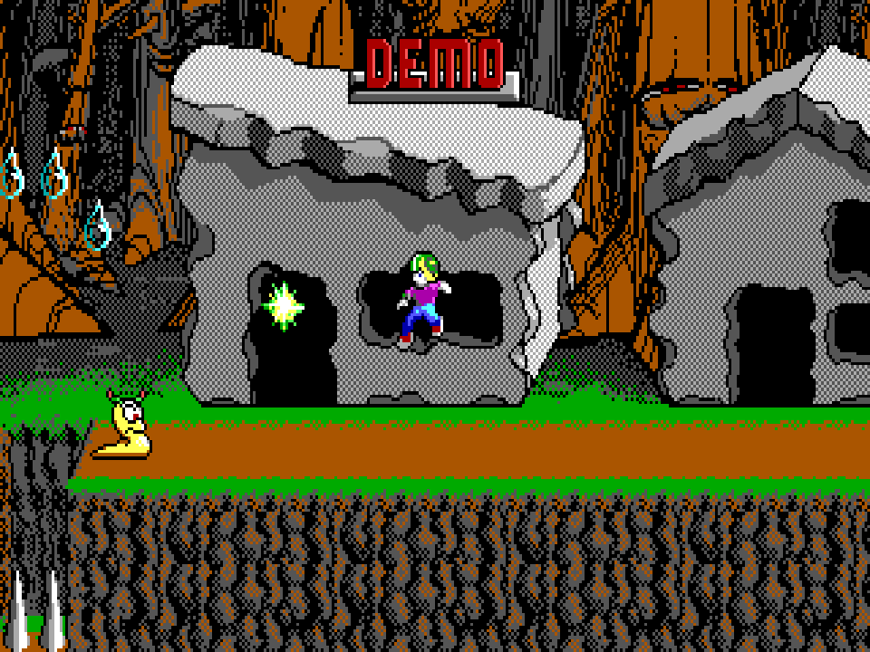
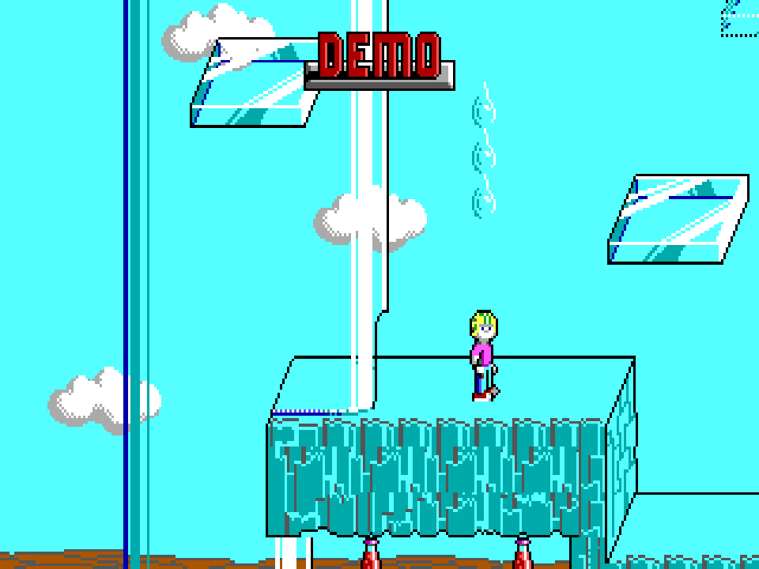
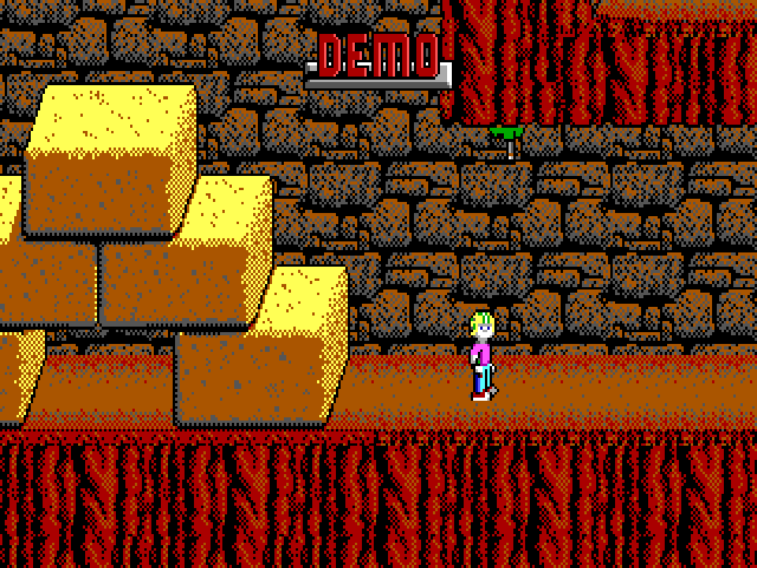
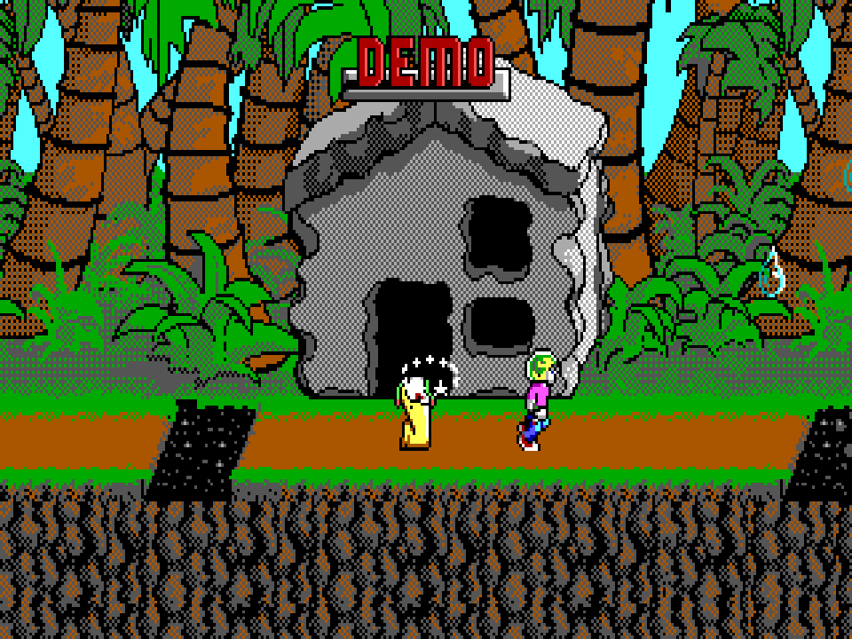

# Commander Keen 4 — Secret of the Oracle (Go)

[Русский](README_RU.md)

A native Go port of the complete **Commander Keen 4 v1.4 EGA** episode for Windows, Linux and macOS, built around the restored Omnispeak engine. Billy Blaze travels through the Shadowlands to rescue the eight members of the Oracle Council. Explore forests, caves, pyramids and underwater areas, use the pogo stick, collect gems and supplies, and stun enemies with the Neural Stunner.

The original levels, EGA artwork, sprites, animations, fonts, menus, physics, enemy logic, difficulty modes, items, story, ending and built-in demonstrations are retained. Rendering uses the original 320×200, 16-colour image, sharp nearest-neighbour scaling and the 4:3 display proportions of a period CRT. Music and effects use the original audio resources, a Go translation of Nuked OPL3 and PC-speaker synthesis.

## Screenshots

Actual frames rendered by this Go engine, enlarged without smoothing:






## Controls

| Key | Action |
| --- | --- |
| Arrow keys / numeric keypad | Move, look, climb poles; aim shots up or down |
| Ctrl | Jump; hold for a higher jump |
| Alt | Toggle the pogo stick |
| Space | Fire the Neural Stunner |
| Ctrl + Alt | Original two-button firing combination |
| Enter / Space on the world map | Enter a level |
| Enter | Confirm a menu choice |
| Esc | Open the original menu / go back |
| F1 | Original help, story and instructions |
| F11 | Toggle fullscreen |

Use **Configure** in the original menu to change the keyboard bindings, sound, music and control device. Connected gamepads use the original joystick control and calibration menus. Save and load games through the original menu; difficulty can be selected when starting a new game.

## Build requirements

Install **Go 1.26 or newer**. The first build needs internet access to download the pinned Go modules. No C compiler, Cgo, SDL development package, MinGW or separately installed game runtime is required. Set `CGO_ENABLED=0`.

The result is **one executable**. Do not distribute the source resources, Go modules, icon files or any `.syso` files alongside it. The game uses the operating system's normal graphics, input and audio APIs. On Linux this means the desktop's X11/OpenGL and audio libraries; those system libraries are not bundled in the executable. A graphical desktop and a working graphics driver are needed. There are no additional application DLLs or SDL libraries to install.

### Prepare the Windows executable icon

From the project root, on your **build host**, run:

```sh
go mod download
go generate .
```

The included Go resource generator reads `icon.ico` and produces `icon_windows_amd64.syso` and `icon_windows_arm64.syso`. `go build` automatically links the matching resource into the Windows EXE. Run the generator **before** setting `GOOS` and `GOARCH` for a different target. These generated files are build intermediates and are deliberately absent from the source archive.

`icon.png` is embedded for the window icon on supported platforms. A standalone macOS command-line executable does not carry a Finder application-bundle icon; creating a `.app` bundle would be a separate packaging step.

### Linux or macOS build host

Run the preparation commands above, then use the command for the target:

| Target | Command |
| --- | --- |
| Windows x64 | `CGO_ENABLED=0 GOOS=windows GOARCH=amd64 go build -trimpath -buildvcs=false -ldflags="-s -w -H=windowsgui" -o keen4-windows-amd64.exe .` |
| Windows ARM64 | `CGO_ENABLED=0 GOOS=windows GOARCH=arm64 go build -trimpath -buildvcs=false -ldflags="-s -w -H=windowsgui" -o keen4-windows-arm64.exe .` |
| Linux x64 | `CGO_ENABLED=0 GOOS=linux GOARCH=amd64 go build -trimpath -buildvcs=false -ldflags="-s -w" -o keen4-linux-amd64 .` |
| Linux ARM64 | `CGO_ENABLED=0 GOOS=linux GOARCH=arm64 go build -trimpath -buildvcs=false -ldflags="-s -w" -o keen4-linux-arm64 .` |
| macOS Intel | `CGO_ENABLED=0 GOOS=darwin GOARCH=amd64 go build -trimpath -buildvcs=false -ldflags="-s -w" -o keen4-macos-amd64 .` |
| macOS Apple Silicon | `CGO_ENABLED=0 GOOS=darwin GOARCH=arm64 go build -trimpath -buildvcs=false -ldflags="-s -w" -o keen4-macos-arm64 .` |

### Windows build host — PowerShell

```powershell
go mod download
go generate .
$env:CGO_ENABLED = "0"
$env:GOOS = "windows"
$env:GOARCH = "amd64"
go build -trimpath -buildvcs=false -ldflags="-s -w -H=windowsgui" -o keen4-windows-amd64.exe .
```

For Windows ARM64, change `GOARCH` to `arm64`. To build Linux or macOS from PowerShell, set `GOOS` to `linux` or `darwin`, select `amd64` or `arm64`, and use `-ldflags="-s -w"` instead of the Windows GUI flags.

## Run and save games

Double-click the Windows EXE. On Linux or macOS, run the matching executable from a terminal:

```sh
./keen4-linux-amd64
```

All game data are built in; the working directory does not matter. Save games, high scores and configuration are created automatically in:

| OS | Directory |
| --- | --- |
| Windows | `%APPDATA%\Keen4Go` |
| Linux | `$XDG_CONFIG_HOME/Keen4Go`, or `~/.config/Keen4Go` |
| macOS | `~/Library/Application Support/Keen4Go` |

These files are player data, not runtime dependencies. The original save format is retained. If no sound device is available, start with `--mute`; music and effects can otherwise be configured through the original menu.

## Compatibility and validation

The Go and C versions of the restored Omnispeak engine were compared using all four original built-in demonstration recordings. **All 2,953 rendered frames matched pixel for pixel** (827, 702, 764 and 660 frames). All 20 map entries loaded successfully and all three decoded planes of every map matched the C engine. A saved game matched its C counterpart byte for byte; loading restored the score and player position. The native Linux window, renderer and audio backend were exercised, including starting a new game, keyboard input, fullscreen toggling and clean window closure. Six x64/ARM64 target builds were checked with Cgo disabled; Windows EXEs were built with the icon resource.

This validation checks the Go translation against Omnispeak. It is not a claim that every possible gameplay situation has been exhaustively compared with the original DOS executable. Complete manual playthroughs and native execution on Windows and macOS have not been performed in this environment.

## Licenses and credits

The combined source project is **GPL-3.0-or-later**; see [LICENSE](LICENSE).

Commander Keen and the original game graphics, levels and audio remain the property of their original copyright holders.
